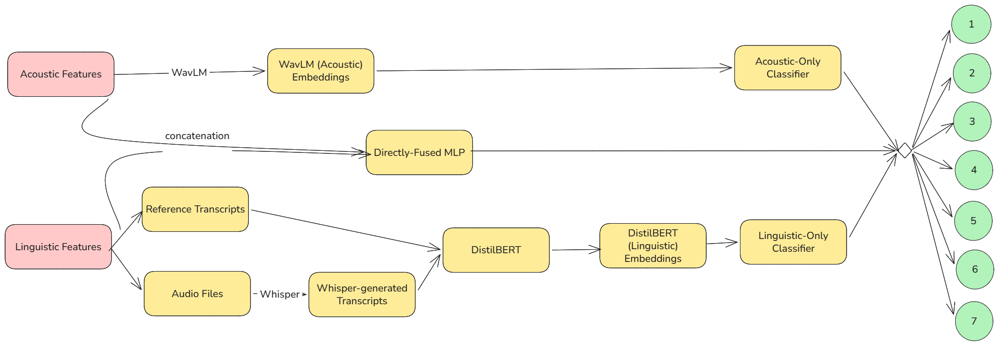

# Acoustic-Linguistic Multimodal Learning for Emotion Classification

## Brief Description
The Acoustic-Linguistic Emotion Classification model is a multimodal, fused system that combines the learned representations of acoustic audio files from the MELD dataset, as well as its linguistic reference transcripts, and additionally, Whisper-generated transcripts from the audio files. The model aims to perform emotion recognition over 7 emotion classes, under limited data, and a speaker-disjoint split. Results of the fused system on comparison with the baselines show a significant improvement, proving that the addition of acoustic/linguistic components to an acoustic/linguistic-only model strengthens its performance. Additional experiments were conducted to test different fusion architectures, tune hyperparameters, test data scarcity during training, and compare reference and whisper transcripts. 

## Deliverables
1. Acoustic-Linguistic fused emotion classifier.
2. Jupyter notebook investigating transcript quality.
3. Ablations notebook to prove modalities are complementary.

## Tools Used
`PyTorch`, `HuggingFace Transformers (WavLM, DistilBERT)`, `Whisper`, `collections`, `mlflow`, `pandas`, `matplotlib`, `Jupyter`

## Architecture Diagram


## How to Run
1. Install Required Libraries: 
`pip install -r requirements.txt`
- Python Version: `3.12.2`
- Pip Version: `26.1.2`
- PyTorch Version: `2.13.0`

2. Data Setup:
- Create train/test/val splits by running `python src/helpers/speaker_split.py`
- Create train/test/val manifests by running `python src/helpers/create_manifest.py`
- *To save time/space, you can delete files that don't exist in the manifests, you can run `python src/helpers/remove_misc.py`
- *If your files are not in `.wav` form, you can convert them using `python src/helpers/convert.sh`
* = Optional

3. Create Embeddings:
Run this process for train/test/val splits.
- Run `python src/features/wavlm_extract.py` to extract WavLM (audio) embeddings. Embeddings are saved at `embeddings/acoustic/`
- Run `python src/features/whisper_extract.py` to create Whisper transcripts. Transcripts are saved at `results/artifacts/`
- Run `python src/features/distilbert_extract.py` to extract DistilBERT (linguistic) embeddings for reference transcripts. Embeddings are saved at `embeddings/linguistic/distilbert_reference/`
- Run `python src/features/distilbert_extract.py` to extract DistilBERT (linguistic) embeddings for Whisper transcripts. Embeddings are saved at `embeddings/linguistic/distilbert_transcript/`
- Run `python src/helpers/mapping.py` immediately after creating the embeddings to convert the emotion labels into numbers the model can understand.

4. Training:
- Run `python -m src.training.train` and pass all the appropriate hyperparameter values you'd like to test. Already trained models are available at `models/`

5. Inference:
- Run `python -m src.evaluation.evaluate` to evaluate the performance of the created model. If you are testing a new model, ensure the path of the model you've created exists in evaluate. Add it to `MODEL_PATHS`

6. Running mlflow:
- Run `mlflow ui --port 8080`

Quick Note: The project is not dockerized yet to run directly, but it will be soon!

## Project Structure

```text
few-shot-rare-disease-classification/
├── embeddings/
│   ├── acoustic/                -> acoustic embeddings created by WavLM
│   ├── linguistic/              -> linguistic embeddings created by DistilBERT
│   └── fused/                   -> acoustic-linguistic fused embeddings created after running src/helpers/dict_mapping.py
│
├── results/
│   ├── artifacts/               -> manifests & whisper transcripts                    
│   ├── models/                  -> trained model checkpoints                    
│   │   ├── baselines/           -> acoustic-only, linguistic-only, and direct fusion models
│   │   ├── data/                -> models trained on scarce data
│   │   ├── fused/               -> models with fusion architecture different than baseline
│   │   ├── tuned                -> models trained on different hyperparameter values
│
├── notebooks/                   -> contains notebooks showing evaluation of baseline models, hyperparameter tuned models, ablations, transcripts comparison.
│
├── src/                        -> core of the model & features
│   ├── data/                   
│   │   ├── eda.ipynb           -> EDA of original dataset
│   │
│   ├── evaluation/             
│   │   └── evaluate.py         -> runs evaluation on test set for a selected checkpoint. measures balanced accuracy & macro-f1
│
│   ├── features/               -> extract embeddings for acoustic & linguistic features, and generate whisper transcripts.
│
│   ├── helpers/             
│   │   ├── convert.sh          -> converts .mp4 files into .wav
│   │   ├── create_manifest.py  -> creates train/val/test manifests
│   │   ├── dict_mapping.py     -> merges acoustic and linguistic embedding files
│   │   ├── mapping.py          -> converts string emotion labels into class numbers
│   │   ├── remove_misc.py      -> deletes files not in manifest
│   │   └── speaker_split.py    -> creates a disjoint speaker split of train/val/test
│
│   ├── models/
│   │   ├── data_scarcity.py    -> creates a sampler that samples given percentage of data
│   │   ├── dataloader.py       -> creates unimodal and multimodal compatible datasets
│   │   ├── early_stopping.py   -> class definition for early stopping
│   │   ├── fusion.py           -> class definitions for direct and projection fusion
│   │   ├── mlp.py              -> class definitions for unimodal MLP                                
│   │   └── weighting.py        -> prioritize classes with less samples by class weighting
│   │
│   ├── training/
│   │   ├── sanity_check.py     -> check number of samples, unique utterances, shapes, emotion distribution                 
│   │   └── train.py            -> train the model based on input hyperparameters
│
├── requirements.txt            # python dependencies
└── README.md                   # project documentation
```

For more detailed discussion of design decisions, results, limitations, and future improvements, please read the report!
